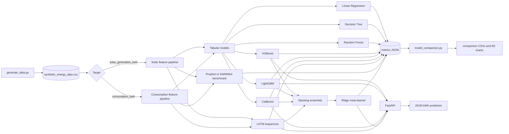
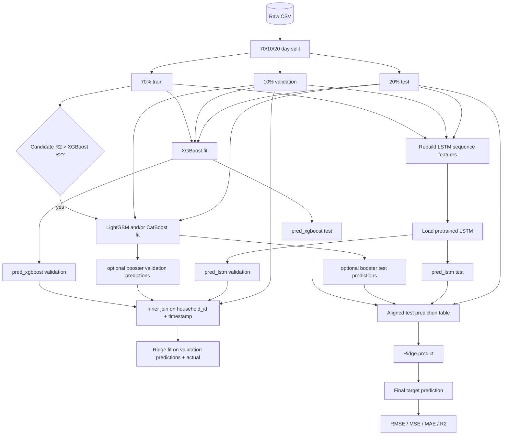
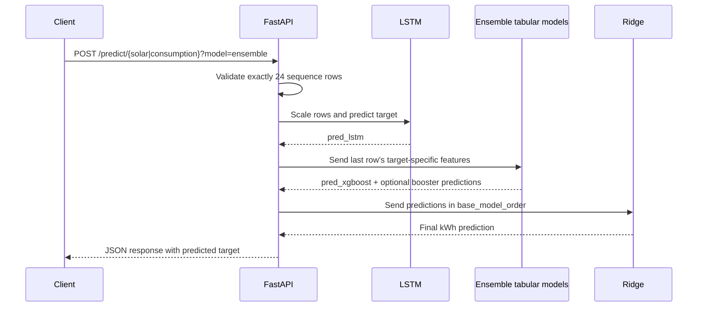

# Model Data Flow

This document describes the model inputs, processing steps, outputs, saved artifacts, and ensemble data flow implemented in this repository. The source of truth is the Python code under `ml-service/`; older result files and README text may contain models from an earlier run.

## 1. Overall Pipeline

```text
synthetic_energy_data.csv
        |
        +--> time-based train/test split ------------------------------+
        |                                                               |
        |    Linear Regression                                         |
        |    Decision Tree                                             |
        |    Random Forest                                             |
        |    XGBoost                                                   |
        |    LightGBM                                                  |
        |    CatBoost                                                  |
        |         |                                                     |
        |         +--> prediction + RMSE/MSE/MAE/R2 + model artifact     |
        |                                                               |
        +--> Prophet/SARIMAX per-household benchmark                    |
        |                                                               |
        +--> 3-way train/validation/test split                         |
             LSTM sequence model                                       |
             XGBoost + optional LightGBM/CatBoost + LSTM               |
                              |
                              +--> Ridge stacking meta-learner         |
                                   final prediction + metrics           |
```

The two regression targets are trained independently:

- `solar_generation_kwh`: hourly solar energy generated by a household.
- `consumption_kwh`: hourly energy consumed by a household.

A solar model never predicts consumption, and a consumption model never predicts solar generation.

### 1.1 System flow diagram



The arrows into the stacking ensemble represent independent prediction streams. They do not mean that one booster receives another booster\'s prediction as a feature.

## 2. Source Dataset

`ml-service/data/generate_data.py` generates 219,000 rows: 25 households x 365 days x 24 hours. Each row represents one household at one timestamp.

### Available columns

| Column                        | Role                                                                    |
| ----------------------------- | ----------------------------------------------------------------------- |
| `timestamp`                   | Time-series ordering and row identity; not passed to tabular regressors |
| `hour`                        | Hour of day, 0-23                                                       |
| `day_of_week`                 | Weekday, 0-6                                                            |
| `day_of_year`                 | Annual seasonality index, 1-365                                         |
| `month`                       | Calendar month                                                          |
| `household_id`                | Household identity                                                      |
| `consumption_profile`         | Small, medium, or large tier; categorical source field                  |
| `consumption_profile_encoded` | Encoded tier: 0, 1, or 2                                                |
| `temperature`                 | Ambient temperature                                                     |
| `solar_irradiance`            | Normalized irradiance, 0-1                                              |
| `panel_capacity_kw`           | Household solar-panel capacity                                          |
| `solar_generation_kwh`        | Solar target and LSTM historical lag value                              |
| `consumption_kwh`             | Consumption target and LSTM historical lag value                        |

The generated target values come from the synthetic formulas in `generate_data.py`, not from model predictions. Solar generation is driven mainly by irradiance and panel capacity. Consumption is driven by household baseline, morning/evening peaks, weekend behavior, and household tier.

## 3. Splitting and Evaluation

### Standard tabular split

`ml-service/train.py` and the LightGBM, CatBoost, and Prophet scripts use `time_based_split`:

- First 80% of calendar days: training.
- Last 20% of calendar days: test.
- All household rows belonging to a day stay in the same split.

Each model receives `X_train` and `y_train`, predicts `X_test`, and is evaluated against the real `y_test`.

### Three-way split

The LSTM and stacking ensemble use `time_based_split_3way`:

- 70% of days: training.
- 10% of days: validation.
- 20% of days: test.

The validation block is used for model selection or meta-learner fitting. The final test block is held back for evaluation.

Every trainer writes metrics containing:

- RMSE
- MSE
- MAE
- R2

Metrics are written to `ml-service/models/metrics/{target}__{model}.json` when the training scripts are run. The comparison script combines those JSON files into result CSVs and charts.

### 3.1 Completed comparison results

The completed run is recorded in `ml-service/results/solar_model_comparison.csv` and `ml-service/results/consumption_model_comparison.csv`. The tables below are sorted by R2, matching the generated files.

#### Solar generation

| Model                 |     RMSE |      MSE |      MAE |       R2 |
| --------------------- | -------: | -------: | -------: | -------: |
| RandomForestRegressor | 0.034528 | 0.001192 | 0.016434 | 0.999722 |
| LGBMRegressor         | 0.036000 | 0.001296 | 0.018527 | 0.999698 |
| XGBRegressor          | 0.036074 | 0.001301 | 0.018595 | 0.999697 |
| CatBoostRegressor     | 0.037422 | 0.001400 | 0.019920 | 0.999674 |
| Ensemble              | 0.037910 | 0.001437 | 0.019695 | 0.999664 |
| DecisionTreeRegressor | 0.049917 | 0.002492 | 0.024379 | 0.999420 |
| LSTM                  | 0.287726 | 0.082786 | 0.148929 | 0.980654 |
| LinearRegression      | 0.694924 | 0.482919 | 0.568968 | 0.887537 |
| Prophet_hh4_small     | 0.349578 | 0.122205 | 0.250147 | 0.746522 |
| Prophet_hh0_medium    | 1.168509 | 1.365413 | 0.875916 | 0.743935 |
| Prophet_hh3_large     | 1.342783 | 1.803065 | 1.047016 | 0.597353 |

#### Consumption

| Model                 |     RMSE |      MSE |      MAE |       R2 |
| --------------------- | -------: | -------: | -------: | -------: |
| Ensemble              | 0.150276 | 0.022583 | 0.119984 | 0.959029 |
| LGBMRegressor         | 0.150235 | 0.022571 | 0.120000 | 0.959016 |
| CatBoostRegressor     | 0.150461 | 0.022638 | 0.120149 | 0.958893 |
| RandomForestRegressor | 0.151514 | 0.022957 | 0.120964 | 0.958316 |
| XGBRegressor          | 0.152566 | 0.023277 | 0.121808 | 0.957734 |
| LSTM                  | 0.162116 | 0.026281 | 0.129245 | 0.952319 |
| DecisionTreeRegressor | 0.215402 | 0.046398 | 0.172189 | 0.915750 |
| Prophet_hh3_large     | 0.329263 | 0.108414 | 0.265647 | 0.868200 |
| Prophet_hh0_medium    | 0.384639 | 0.147947 | 0.326196 | 0.607153 |
| Prophet_hh4_small     | 0.314493 | 0.098906 | 0.252112 | 0.490725 |
| LinearRegression      | 0.540311 | 0.291936 | 0.427950 | 0.469901 |

**Result interpretation:** Random Forest is the best solar model by R2. The consumption ensemble is the best consumption model by R2, but only narrowly beats standalone LightGBM. The ensemble is not automatically the best model for every target.

## 4. Model-by-Model Data Flow

### 4.1 Linear Regression

**Implementation:** `ml-service/train.py`

**Inputs:**

For solar:

```text
hour, day_of_week, day_of_year, month,
household_id, temperature, solar_irradiance, panel_capacity_kw
```

For consumption:

```text
hour, day_of_week, household_id, temperature,
consumption_profile_encoded
```

**Training:** fits a linear function from the selected features to the target.

**Output:** one continuous prediction per test row:

```text
predicted_solar_generation_kwh
or
predicted_consumption_kwh
```

The trained estimator is retained in memory for comparison. If it is the best Phase 1 model, it is saved as `best_{target}_model.pkl`.

### 4.2 Decision Tree Regressor

**Implementation:** `ml-service/train.py`

**Inputs:** exactly the same solar and consumption feature lists shown for Linear Regression.

**Training:** fits one decision tree to learn non-linear thresholds and interactions.

**Output:** one scalar target prediction for each test row. The prediction is evaluated and included in the Phase 1 comparison. The model is not given another model's prediction as an input.

### 4.3 Random Forest Regressor

**Implementation:** `ml-service/train.py`

**Inputs:** exactly the same target-specific tabular features.

**Training:** fits 200 decision trees with the configured depth and minimum leaf size, then averages their predictions.

**Output:** one scalar solar or consumption prediction per row. The best Phase 1 model is saved as `best_solar_model.pkl` or `best_consumption_model.pkl` when it wins the R2 comparison.

The completed comparison shows Random Forest as the best solar model. For consumption, the completed ensemble has the highest R2.

### 4.4 XGBoost

**Implementation:** `ml-service/train.py` and `ml-service/models/train_ensemble.py`

**Standalone input:** the same target-specific tabular features as the other tabular regressors.

**Standalone training flow:**

```text
features -> XGBRegressor.fit -> prediction -> evaluation metrics
```

`train.py` saves a dedicated standalone artifact for API use:

```text
models/trained_models/xgboost_solar_model.pkl
models/trained_models/xgboost_consumption_model.pkl
```

The ensemble does not reuse these standalone estimators. `train_ensemble.py` fits a fresh XGBoost model on the ensemble's 70% training block so its validation predictions do not overlap with the data used to fit the Ridge meta-learner. Those fresh models are saved as:

```text
ensemble_xgboost_solar_model.pkl
ensemble_xgboost_consumption_model.pkl
```

**Output:** a scalar prediction for the requested target. In the ensemble, the scalar is renamed to `pred_xgboost` and becomes one column of the Ridge meta-learner's input.

### 4.5 LightGBM

**Implementation:** `ml-service/models/train_lightgbm.py` and `train_ensemble.py`

**Inputs:** the same solar or consumption tabular feature list used by XGBoost.

**Standalone flow:**

```text
features -> LGBMRegressor.fit -> prediction -> evaluation metrics
```

Standalone predictions are evaluated against the test target and the model is saved as `lightgbm_solar_model.pkl` or `lightgbm_consumption_model.pkl` for API selection.

**Ensemble flow:** LightGBM is conditional. `train_ensemble.py` reads the standalone XGBoost and LightGBM R2 JSON files. It trains and adds an ensemble LightGBM base model only when:

```text
LightGBM R2 > XGBoost R2
```

When included, its prediction is a separate feature named `pred_lightgbm` for the Ridge meta-learner. It does not receive XGBoost's prediction as an input.

### 4.6 CatBoost

**Implementation:** `ml-service/models/train_catboost.py` and `train_ensemble.py`

**Inputs:** the same solar or consumption tabular feature list used by XGBoost and LightGBM.

**Standalone flow:**

```text
features -> CatBoostRegressor.fit -> prediction -> evaluation metrics
```

Standalone models are saved as `catboost_solar_model.pkl` and `catboost_consumption_model.pkl`.

**Ensemble flow:** CatBoost is also conditional and is independently compared with XGBoost. It is included when its R2 is greater than XGBoost's R2. If included, it produces a separate `pred_catboost` column for Ridge. It does not consume the XGBoost or LightGBM output.

Both candidate boosters can be included, or only one, or neither. The exact order is stored in `ensemble_{slug}_config.json`.

### Actual completed ensemble membership

The trained configuration files show the exact base-model handoff used in the reported results:

| Target           | `base_model_order`                        |
| ---------------- | ----------------------------------------- |
| Solar generation | `xgboost -> lightgbm -> lstm`             |
| Consumption      | `xgboost -> lightgbm -> catboost -> lstm` |

Therefore CatBoost was selected for the consumption stack but not the solar stack. LightGBM was selected for both. The corresponding ensemble model files, Ridge meta-learners, and configuration JSON files are present under `ml-service/models/trained_models/`.

## 4.9 Model input/output summary

| Model             | Input shape                                 | Main transformation                                 | Output                                        |
| ----------------- | ------------------------------------------- | --------------------------------------------------- | --------------------------------------------- |
| Linear Regression | One solar or consumption row                | Linear weighted combination                         | One kWh scalar                                |
| Decision Tree     | One target-specific row                     | Recursive feature splits                            | One kWh scalar                                |
| Random Forest     | One target-specific row                     | Average of 200 trees                                | One kWh scalar                                |
| XGBoost           | One target-specific row                     | Sequential boosted trees                            | One kWh scalar, or `pred_xgboost` in stack    |
| LightGBM          | One target-specific row                     | Leaf-wise boosted trees                             | One kWh scalar, or optional `pred_lightgbm`   |
| CatBoost          | One target-specific row                     | Boosted trees                                       | One kWh scalar, or optional `pred_catboost`   |
| Prophet/SARIMAX   | One household timestamp series              | Seasonal time-series forecast                       | One forecast per future timestamp             |
| LSTM              | 24 rows x target-specific sequence channels | Cyclical encoding, MinMax scaling, recurrent layers | One inverse-scaled kWh scalar, or `pred_lstm` |
| Ridge ensemble    | One row of base predictions                 | Learned linear blend with Ridge                     | Final kWh scalar                              |

### 4.7 Prophet, with SARIMAX fallback

**Implementation:** `ml-service/models/train_prophet.py`

Prophet is intentionally a univariate benchmark rather than a pooled feature-based model.

**Input:** for one household and one target, only:

```text
ds = timestamp
y  = solar_generation_kwh or consumption_kwh
```

It does not receive temperature, irradiance, panel capacity, household ID, or consumption profile. It forecasts the timestamps in the test block using daily, weekly, and yearly seasonality.

Only one representative household from each tier is evaluated:

- Household 4: small.
- Household 0: medium.
- Household 3: large.

Therefore Prophet produces six benchmark result rows: three households for solar and three for consumption. It is not a pooled 25-household model and is not included in the stacking ensemble.

If Prophet cannot be installed or its initial fit fails, the script uses SARIMAX with the target's timestamp-indexed series, `(1, 0, 1)` order, and daily seasonal period 24. The output is still one forecast per test timestamp, but the metric name is prefixed `SARIMAX_fallback_`.

Prophet/SARIMAX predictions are evaluated and written to the metrics JSON files. They are not persisted as live API model artifacts, and the API rejects `model=prophet` for live prediction.

### 4.8 LSTM

**Implementation:** `ml-service/models/train_lstm.py`

The LSTM is one pooled model per target covering all 25 households. It is the only model here that consumes a sequence rather than one independent tabular row.

#### Feature construction

Before sequence creation:

1. `hour`, `day_of_week`, and for solar also `day_of_year` are converted to sine/cosine cyclical features.
2. Numeric scale columns are MinMax-scaled using the training block only.
3. The target is also MinMax-scaled using the training block only.

Solar sequence feature channels:

```text
hour_sin, hour_cos,
dow_sin, dow_cos,
doy_sin, doy_cos,
temperature_scaled,
solar_irradiance_scaled,
panel_capacity_kw_scaled,
household_id_scaled,
solar_generation_kwh_scaled
```

Consumption sequence feature channels:

```text
hour_sin, hour_cos,
dow_sin, dow_cos,
temperature_scaled,
household_id_scaled,
consumption_profile_encoded_scaled,
consumption_kwh_scaled
```

The final channel is the historical target lag channel. It is not the future label being predicted.

#### Sequence-to-output flow

For each household independently:

```text
previous 24 hourly rows -> LSTM -> one scaled target prediction
```

The window contains rows `i-24` through `i-1`; row `i` is the label. Windows never cross household boundaries or train/validation/test boundaries. The first 24 hours of each household cannot produce a prediction.

The predicted scaled value is inverse-transformed back to kWh. The output is therefore one `solar_generation_kwh` or `consumption_kwh` value for the next row in the sequence. The model and both scalers are saved as:

```text
lstm_solar_model.keras
lstm_solar_target_scaler.pkl
lstm_solar_features_scaler.pkl
lstm_consumption_model.keras
lstm_consumption_target_scaler.pkl
lstm_consumption_features_scaler.pkl
```

In the ensemble, the LSTM prediction becomes the `pred_lstm` column.

## 5. Detailed Stacking Ensemble Data Flow

**Implementation:** `ml-service/models/train_ensemble.py`

The ensemble is a stacking model. It is important to describe it correctly:

> XGBoost, LightGBM, and CatBoost do not run one after another with the previous model's prediction as their feature. They all receive the original input features independently. Their predictions, together with the LSTM prediction, are passed side by side to a Ridge meta-learner.

### 5.0 Ensemble diagram



The conditional branch can add LightGBM, CatBoost, both, or neither. XGBoost and LSTM are always present in the ensemble when TensorFlow and the required artifacts are available.

### 5.1 Ensemble training sequence

The following happens independently for solar and consumption:

#### Step 1: Load and split the raw dataset

```text
synthetic_energy_data.csv
    -> time_based_split_3way
    -> train_df (70%), val_df (10%), test_df (20%)
```

The same day boundaries are reused for every base model.

#### Step 2: Train the XGBoost base model

```text
train_df[solar_features or consumption_features]
    + train_df[target]
    -> fresh XGBRegressor.fit
    -> XGBoost validation predictions: pred_xgboost
    -> XGBoost test predictions: pred_xgboost
```

The ensemble's XGBoost is a fresh model, separate from the standalone API XGBoost artifact.

#### Step 3: Optionally train LightGBM and CatBoost base models

For each candidate independently:

```text
candidate R2 > standalone XGBoost R2?
    yes -> fit candidate on the same train_df
           -> validation prediction pred_lightgbm or pred_catboost
           -> test prediction pred_lightgbm or pred_catboost
    no  -> candidate is omitted
```

This means the actual base-model list can be one of the following shapes:

```text
[xgboost, lstm]
[xgboost, lightgbm, lstm]
[xgboost, catboost, lstm]
[xgboost, lightgbm, catboost, lstm]
```

#### Step 4: Load and reproduce the LSTM feature pipeline

```text
train_df + val_df + test_df
    -> add cyclical features
    -> rebuild the same train-fitted scaling logic
    -> create 24-hour sequences per household
    -> load pretrained LSTM
    -> inverse-scale predictions
    -> validation prediction pred_lstm
    -> test prediction pred_lstm
```

The LSTM has no prediction for its first 24-hour window per household. This is why alignment is done by keys rather than by row position.

#### Step 5: Align all base predictions

Each base prediction includes:

```text
household_id, timestamp, pred
```

The ensemble inner-joins all base prediction tables on `(household_id, timestamp)`. It then inner-joins the actual target value on the same keys. Rows unavailable from the LSTM are naturally removed.

The resulting validation table has this conceptual shape:

| household_id  | timestamp | pred_xgboost | pred_lightgbm? | pred_catboost? |  pred_lstm |      actual |
| ------------- | --------- | -----------: | -------------: | -------------: | ---------: | ----------: |
| household key | time key  |   prediction |       optional |       optional | prediction | true target |

The test table has the same prediction columns and actual target, but it is never used to fit the Ridge learner.

#### Step 6: Train the Ridge meta-learner

```text
validation prediction columns
    [pred_xgboost, optional pred_lightgbm, optional pred_catboost, pred_lstm]
        + validation actual target
        -> Ridge.fit
        -> learned combination of base predictions
```

Ridge learns how much to rely on each base model's output. It receives predictions, not the original raw feature columns.

#### Step 7: Produce the final ensemble output

```text
test base predictions
    [pred_xgboost, optional booster predictions, pred_lstm]
    -> columns ordered using base_model_order
    -> Ridge.predict
    -> final solar_generation_kwh or consumption_kwh prediction
    -> RMSE/MSE/MAE/R2 against test actuals
```

The final ensemble metric is written as model name `Ensemble`. The Ridge model and its column-order configuration are saved as:

```text
ridge_solar_meta.pkl
ridge_consumption_meta.pkl
ensemble_solar_config.json
ensemble_consumption_config.json
```

The configuration file records the exact base-model order expected by Ridge. This is necessary because Ridge treats column positions as meaningful.

### 5.8 Concrete example of the Ridge handoff

If the configuration contains:

```json
{ "base_model_order": ["xgboost", "lightgbm", "lstm"] }
```

then the handoff is:

```text
original features -> XGBoost  -> 0.81 ┐
original features -> LightGBM  -> 0.79 ├-> [0.81, 0.79, 0.76] -> Ridge -> 0.80 kWh
24-hour sequence  -> LSTM      -> 0.76 ┘
```

The numeric values above are illustrative only. The important fact is the column order: Ridge receives the three predictions in exactly the order recorded in `base_model_order`, and the actual target is used only while fitting/evaluating the meta-learner.

## 6. Live API Data Flow

**Implementation:** `ml-service/api/main.py`

The API loads model artifacts once during application startup. It supports `xgboost`, `lightgbm`, `catboost`, `lstm`, and `ensemble` choices. Prophet is intentionally rejected for live prediction.

### Standalone tabular request

For `POST /predict/solar?model=xgboost` or another tabular choice:

```text
one validated request row
    -> select target-specific feature columns
    -> selected standalone tabular model
    -> one scalar prediction
    -> {"predicted_solar_generation_kwh": value}
```

Consumption uses the analogous response key `predicted_consumption_kwh`.

### Live LSTM request

The client sends exactly 24 rows. Each row includes the ordinary input fields plus the observed target value for that past hour, because that target value is needed as the lag channel.

```text
24 validated historical rows
    -> cyclical feature construction
    -> loaded feature and target scalers
    -> shape (1, 24, n_features)
    -> LSTM
    -> inverse target scaling
    -> one scalar prediction
```

### Live ensemble request

The API first computes the LSTM prediction, then uses the final row's tabular features for each ensemble tabular base model:

```text
24 request rows
    -> LSTM -> pred_lstm

last request row's target-specific tabular features
    -> ensemble XGBoost -> pred_xgboost
    -> optional ensemble LightGBM -> pred_lightgbm
    -> optional ensemble CatBoost -> pred_catboost

[predictions in ensemble_config.json order]
    -> Ridge meta-learner
    -> final scalar prediction
```

So at serving time, the tabular models still do not consume one another's outputs. The only model that feeds directly into the Ridge input from a sequence is the LSTM, and all base predictions are combined side by side.

### 6.1 API sequence diagram



## 7. Generated Outputs and Artifacts

| Producer                      | Generated output                                                                        |
| ----------------------------- | --------------------------------------------------------------------------------------- |
| `generate_data.py`            | `data/synthetic_energy_data.csv`                                                        |
| Phase 1 `train.py`            | comparison CSVs, metrics JSON files, best-model artifacts, standalone XGBoost artifacts |
| `train_lightgbm.py`           | LightGBM metrics and standalone LightGBM artifacts                                      |
| `train_catboost.py`           | CatBoost metrics and standalone CatBoost artifacts                                      |
| `train_prophet.py`            | Prophet/SARIMAX per-household metrics only                                              |
| `train_lstm.py`               | LSTM models, scalers, and LSTM metrics                                                  |
| `train_ensemble.py`           | ensemble base models, Ridge meta-learners, config JSON, ensemble metrics                |
| `results/model_comparison.py` | full comparison CSVs and R2 bar charts                                                  |
| `api/main.py`                 | JSON response containing one predicted kWh value                                        |

The completed run contains trained artifacts for the active Phase 1 models, LightGBM, CatBoost, LSTM, both target-specific ensembles, their Ridge meta-learners, and the comparison CSVs/charts. SVR remains only in the older `ml-service/models/*_comparison.csv` files and is not part of the current executable `train.py` model list because its definition is commented out.
